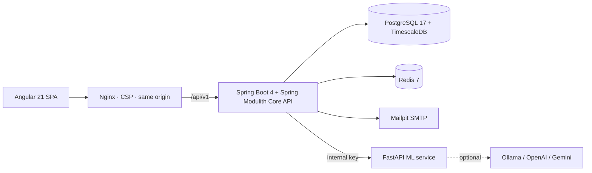
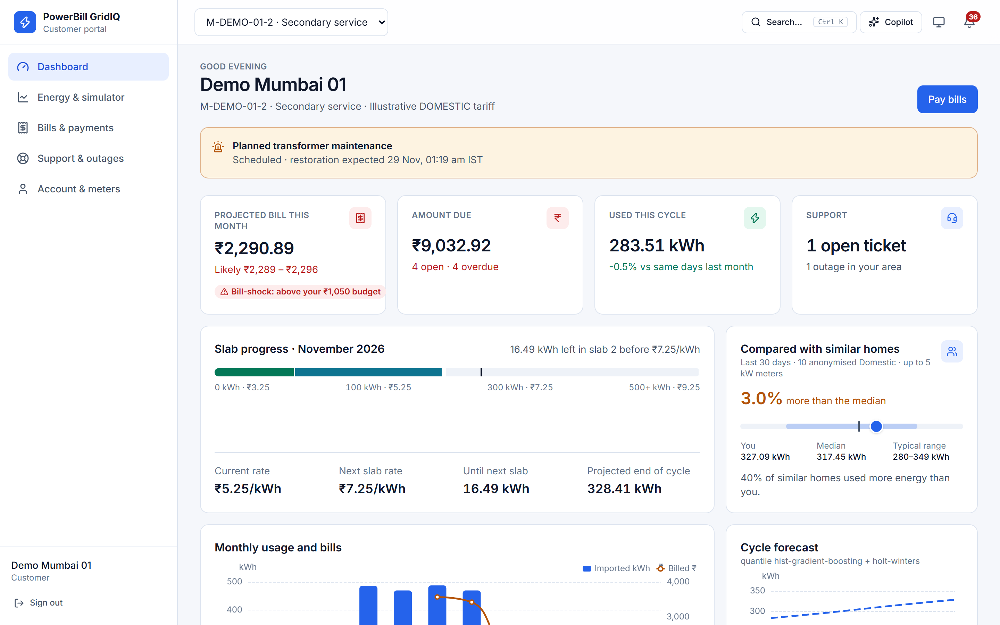
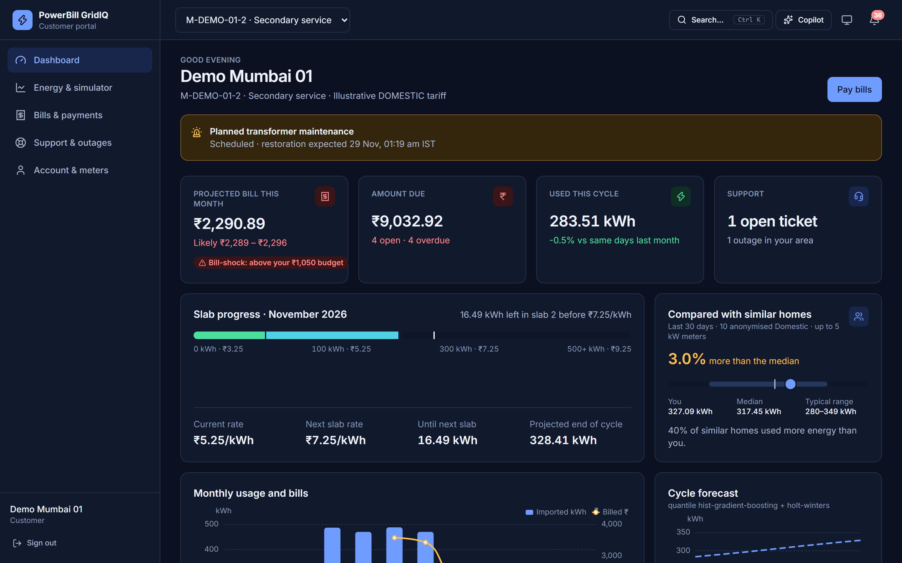
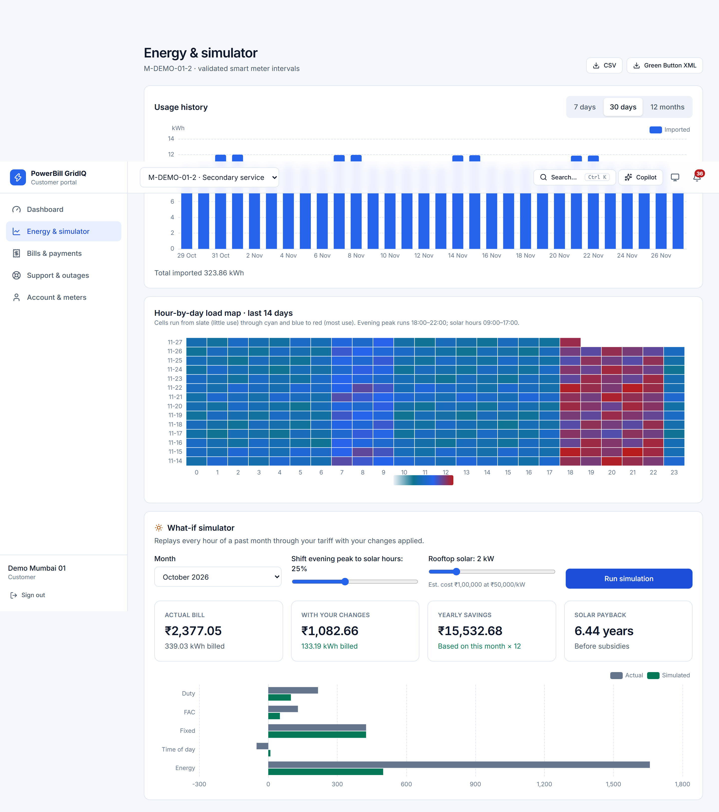
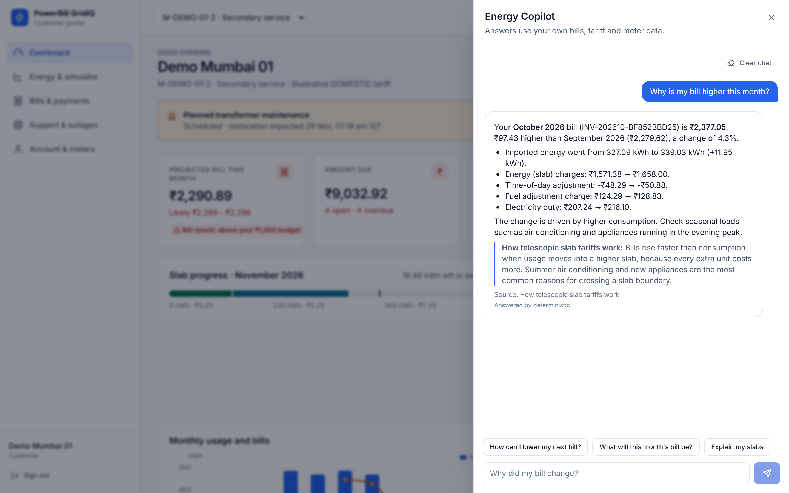
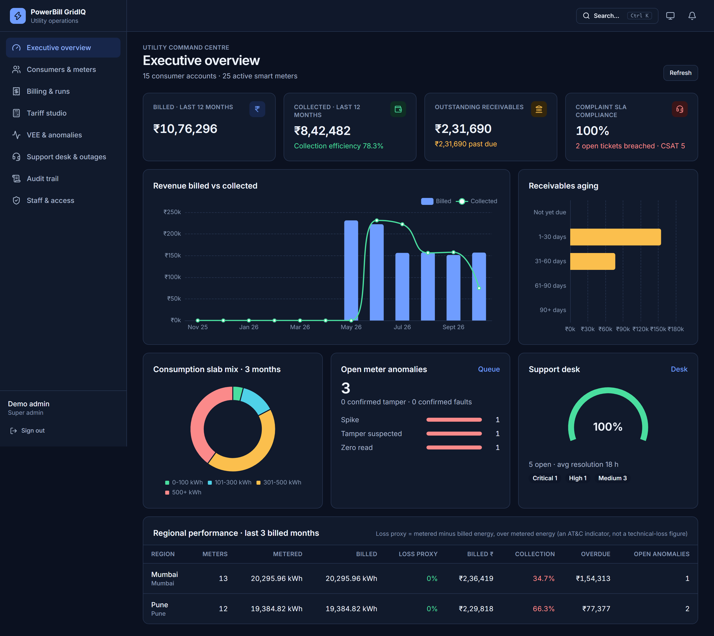

# PowerBill GridIQ

GridIQ is a utility customer information and billing platform for Indian electricity distribution. It turns hourly
smart meter (AMI) readings into transparent, itemized bills under telescopic slab, time-of-day and rooftop solar
net-metering tariffs. Customers see every rupee explained and receive bill-shock warnings before the month ends.
Utility staff run billing cycles, investigate anomalies and work an SLA-tracked support desk. The stack runs locally
with free, open-source components and no paid API keys.



## Screenshots

| Customer dashboard (light) | Customer dashboard (dark) |
| --- | --- |
|  |  |
| **Energy and what-if simulator** | **Energy Copilot** |
|  |  |



Refresh them against a running demo stack with `CAPTURE_SCREENSHOTS=1 E2E_DEMO_PASSWORD=<DEMO_PASSWORD> npx playwright test screenshots`
from `frontend`.

## What it does

| Area | Highlights |
| --- | --- |
| Smart metering | Hourly TimescaleDB hypertable with continuous aggregates, VEE checks (load, export, voltage, power factor), CSV and Green Button ESPI import and export, estimation and audited corrections, staff VEE tools for inspecting flagged and missing hours, and a 12-month AMI simulator with injected tamper, flatline and night-baseload scenarios |
| Tariff engine | Effective-dated, versioned plans with telescopic slabs, time-of-day windows, solar carry-forward or cash credit, fixed charge per kW, FAC, electricity duty and GST, all computed with `BigDecimal` to the paisa, plus a what-if simulator for load shifting and rooftop solar payback |
| Billing and payments | Immutable invoices enforced by a database trigger, idempotent batch billing runs with dry-run preview, credit and debit notes, accrued late fees, a double-entry ledger whose journals must balance at commit, atomic multi-bill checkout with `Idempotency-Key`, auto-pay, a payment gateway interface with an HMAC-SHA256 signed sandbox, and PDF invoices and receipts with QR codes |
| Support and outages | Complaint state machine with SLA deadlines and breach sweeps, public replies and internal notes, CSAT, and outage incidents targeted by pincode |
| Notifications | Spring Modulith events drive in-app notifications, live Server-Sent Events fanned out across instances through Redis pub/sub, and HTML email through Mailpit |
| Intelligence | Quantile gradient-boosting and Holt-Winters cycle forecasts priced through the real tariff engine, explainable anomaly detection (rules plus Isolation Forest), and an Energy Copilot and agent triage assistant whose numbers always come from the ledger |
| Customer insight | An anonymous comparison with similar homes (same connection type and load band, shown only when at least four peers exist), bill-shock warnings against a monthly budget, and CSV export of bills and payments |
| Operations | Executive KPIs (billed vs collected, collection efficiency, aging, slab mix, anomalies, SLA compliance) with a regional loss-proxy and collection table, a consumer 360° view with contact, budget and meter changes, a tariff studio with a draft editor, a support desk with table and Kanban views, a Ctrl+K command palette, RBAC for five roles and an append-only audit trail with recorded state |

## Run locally

1. Start Docker. Copy the example environment file and enable the demo data:

   ```sh
   cp .env.example .env
   # then set DEMO_MODE=true and DEMO_PASSWORD to a local password of 12+ characters
   ```

2. Build and start the stack:

   ```sh
   docker compose up --build --wait
   ```

3. Open [GridIQ](http://127.0.0.1:8080/) and sign in with a [demo account](docs/DEMO_ACCOUNTS.md). The first start
   seeds 12 months of hourly readings, 150 invoices, 112 payments, support tickets, outages and anomalies, which takes
   about a minute. [Mailpit](http://127.0.0.1:8025/) shows every email the platform sends.

Compose generates database, Redis and ML service credentials on first start and keeps them in named volumes. Only the
web app and Mailpit bind to the host, on loopback. Stop the stack with `docker compose down`; add `-v` to delete the
data and start over.

Optional profiles:

| Profile | Command | Adds |
| --- | --- | --- |
| Observability | `docker compose -f docker-compose.yml -f docker-compose.observability.yml up -d` | Prometheus on `127.0.0.1:9090` and Grafana on `127.0.0.1:3000` with a provisioned GridIQ dashboard. Set `GRAFANA_ADMIN_PASSWORD` first. |
| Local LLM | `docker compose -f docker-compose.yml -f docker-compose.ai-local.yml up -d` | Ollama for the Copilot. Pull a model once with `docker compose exec ollama ollama pull llama3.2:3b`. Answers that introduce numbers not in the customer's data are rejected in favour of the deterministic answer. |

## Checks

| Component | Command | Current result |
| --- | --- | --- |
| Core API, from `backend` | `./mvnw verify` (`mvnw.cmd verify` on Windows) | 52 tests: Testcontainers integration suites, unit tests for the AI service and error handling, 26 tariff engine cases and the Spring Modulith boundary check; 87% line coverage (JaCoCo report in `target/site/jacoco`) |
| ML service, from `ml-service` in a Python 3.12+ venv | `pip install -e '.[dev]'`, `ruff check .`, `pytest --cov=app` | 75 tests with 91% coverage, including forecast MAPE under 15%, midnight IST alignment, recall of three injected anomaly scenarios and the copilot grounding guard |
| Frontend, from `frontend` | `npm ci`, `npm run lint`, `npm test`, `npm run build` | Lint clean, 21 unit tests, 343 kB initial bundle (91 kB gzipped) with no budget warnings |
| End-to-end, from `frontend` with the demo stack running | `E2E_DEMO_PASSWORD=<DEMO_PASSWORD> npm run e2e` | 22 Playwright journeys covering security headers, payments, Copilot, complaints, staff workflows, account switching, the command palette, VEE tools, the Kanban desk, auto-pay, and a clean console with no horizontal scroll at 375, 768 and 1440 px |
| Load | see [k6-smoke.js](tests/load/k6-smoke.js); add `K6_PROFILE=mixed` for the mixed workload | Smoke, 25 virtual users: p95 of 9 ms with 0% errors over 7,410 requests. Mixed, 100 virtual users plus forecasts, Copilot chat and the executive overview: p95 of 10 ms (Copilot 35 ms) with 0% errors over 29,283 requests |

## Documentation

- [Architecture and decisions](docs/ARCHITECTURE.md)
- [API guide](docs/API_GUIDE.md)
- [Security](docs/SECURITY.md)
- [Demo accounts](docs/DEMO_ACCOUNTS.md) and the [5-minute walkthrough](docs/DEMO_WALKTHROUGH.md)
- [Contributing](CONTRIBUTING.md)

## Project layout

```text
backend/      Spring Boot 4 + Spring Modulith Core API (identity, consumer, metering, tariff, billing, payment,
              support, notification, analytics, audit) with Flyway migrations
ml-service/   FastAPI forecasting, anomaly detection and copilot service with a local knowledge base
frontend/     Angular 21 zoneless SPA (customer portal and operations portal) and Playwright tests
infra/        Nginx, Compose start scripts, Prometheus and Grafana provisioning
tests/load/   k6 load smoke test
docs/         Architecture, API, security and demo guides
```

GridIQ source is MIT licensed. The original training project is preserved at the `legacy-ilp-archive` Git tag.
Demonstration tariffs are illustrative and are not issued by any electricity regulator.
