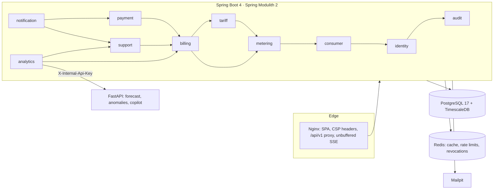

# GridIQ architecture

GridIQ is a modular monolith for transactions plus a separate Python service for analytics. The Core API owns every
financial record and the public API. The ML service is stateless: the Core API sends it the data it needs and stores
the results. A single Angular application talks to the Core API through Nginx on the same origin.

## Modules

Each module exposes a small public API (interfaces, records and events) in its root package and keeps controllers,
stores and services in `internal`. `ModularityTests` verifies the declared dependencies on every build.

| Module | Owns | Public API |
| --- | --- | --- |
| identity | Users, Argon2id passwords, JWT access tokens, rotating refresh cookies, staff RBAC | `CustomerIdentity`, `StaffDirectory`, `UserDirectory` |
| consumer | Accounts, premises, meters, status changes | `MeterDirectory`, `AccountDirectory` |
| metering | Hourly readings, VEE, imports and exports, AMI simulator, anomaly register | `MeterUsage`, `AnomalyRegistry`, `MeteringEvents` |
| tariff | Versioned plans and the pricing engine | `TariffPricing`, `TariffPlan` |
| billing | Invoices, line items, notes, late fees, billing runs, the receivable ledger | `BillingLedger`, `BillingStatistics`, `BillingEvents` |
| payment | Checkout, idempotency, sandbox gateway, webhooks, receipts | `PaymentEvents` |
| support | Complaints, SLA sweeps, comments, CSAT, outages | `SupportDirectory`, `SupportEvents` |
| notification | In-app notifications, SSE streams, email | event listeners only |
| analytics | Dashboards, forecasts, ML client, copilot context, anomaly scans, budget alerts | `AnalyticsEvents` |
| audit | Append-only audit log | `AuditAction` event |

Cross-module side effects travel as events. Audit entries and notifications use `@ApplicationModuleListener`, so they
run after the business transaction commits and are recorded in the JDBC event publication registry.

## Key flows

**Billing.** A run takes each active meter, reads the month's validated hourly intervals (flagged hours are excluded,
at least 90% coverage is required), picks the tariff in force on the first day, carries the previous kWh solar credit
forward and prices the intervals. The bill, its line items and a journal are written in one transaction per meter, so
one failing meter does not stop the run. A unique `(meter, year, month)` constraint and the run's `Idempotency-Key`
make retries safe. A trigger rejects any change to an issued bill's amounts; corrections are credit or debit notes.

**Ledger.** Every financial event writes a journal of debits and credits. A deferred constraint trigger rejects any
journal that does not balance when the transaction commits. The customer statement is the running balance of the
receivable account.

**Payment.** Checkout locks the selected bills in a stable order, prices principal plus late fee on the server and
stores the allocation. A replay with the same `Idempotency-Key` returns the original payment; a different body is
rejected with HTTP 422. A bill with an open checkout cannot be checked out again. The gateway's webhook is verified with
HMAC-SHA256 and a five-minute timestamp window, recorded by event ID and processed under a row lock. Settlement
validates every bill before changing any of them, so a multi-bill payment settles completely or is marked failed for
refund. The built-in sandbox signs and posts its events through exactly this path.

**Forecasts.** The ML service predicts daily consumption bands for the rest of the cycle. The Core API spreads each
day over the meter's own hourly load shape and prices the result with the tariff engine, so time-of-day and slab
effects are exact. Model forecasts are cached in Redis per meter and day, concurrent requests share one model call,
and the Core API falls back to a 14-day run rate within eight seconds if the ML service is unavailable.

**Copilot.** The Core API assembles a read-only context for the signed-in customer (recent bills with line items,
receivables, tariff, forecast, time-of-day split, complaints, outages and meter anomalies). The ML service answers
deterministically from that context and cites the local tariff guide it retrieved with TF-IDF. An optional LLM may
rephrase the answer; any rephrasing that contains a number absent from the facts is discarded.

## Decisions

| Decision | Reason |
| --- | --- |
| Modular monolith instead of microservices | Multi-bill payments, ledger journals and invoices need one ACID transaction. Spring Modulith keeps boundaries enforceable and lets modules be extracted later. |
| Separate Python ML service | scikit-learn and the LLM adapters belong in Python. The service holds no data and needs no database access. |
| JdbcClient over JPA entities | Financial queries, row locks and TimescaleDB functions are explicit SQL. Records map rows without lazy-loading surprises. |
| TimescaleDB for readings | Hypertables and continuous aggregates keep daily and hour-of-day rollups fast as interval data grows. |
| Access token in memory, refresh token in an HttpOnly cookie | Nothing sensitive is stored in `localStorage`; refresh rotation detects token reuse and revokes the session family. |
| Fetch-based Server-Sent Events | The stream carries the bearer token in a header rather than a URL. Persisted notifications remain the source of truth after reconnects. |
| No inline styles | Components use Tailwind utilities only, so the CSP can keep `style-src 'self'`. |

## Versions

| Component | Version |
| --- | --- |
| Java baseline and Maven Wrapper | Java 21 (verified on JDK 25) and Maven 3.9.16 |
| Spring Boot, Spring Modulith and Springdoc | 4.2.0, 2.2.0 and 3.2.1 |
| Flyway and Testcontainers | 12.11.0 and 2.0.5 |
| OpenPDF and ZXing | 2.4.0 and 3.5.3 |
| Angular, Tailwind CSS and ECharts | 21.2, 4.3 and 6.1 |
| Python, FastAPI, scikit-learn and NumPy | 3.12+, 0.165.0, 1.9.0 and 2.4.2 |
| Storage | PostgreSQL 17 with TimescaleDB Community Edition 2.x and Redis 7.2 |

GridIQ source is MIT licensed. Continuous aggregates require TimescaleDB Community Edition, which is free for
self-hosting under the Timescale License. The Redis 7.2 series is BSD 3-Clause licensed.

## Known limits

- SSE fan-out is held in memory, so live notifications reach clients connected to the same Core API instance. Running
  several instances would need Redis pub/sub for fan-out; persisted notifications are unaffected.
- The ML service runs two Uvicorn workers. Prometheus metrics from the service reflect the worker that serves the scrape.
- Only the built-in sandbox gateway is implemented. Stripe or Razorpay adapters would post to the same webhook handler.
- Auto-pay mandates are stored on the account but not executed.
