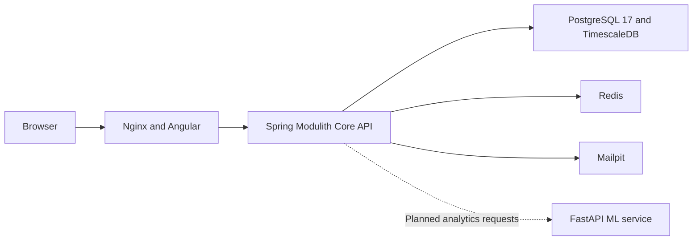

# GridIQ architecture

The Spring Modulith Core API owns utility transactions and the public API. The FastAPI service runs separately so Python analytics libraries and compute can evolve independently. A single Angular application uses same-origin requests through Nginx. Indian electricity billing and a zero-key deterministic Copilot are the defaults for the planned product modules.

Nginx exposes the SPA, versioned Core API, and the liveness and readiness probes. Core API metrics, OpenAPI, the ML service, PostgreSQL, and Redis use the Compose networks. Only the frontend and Mailpit web inbox bind to the host, on loopback by default. PostgreSQL runs with a dedicated application role and a Flyway-managed `gridiq` schema. The `public` schema supplies the TimescaleDB extension.

The Core API declares the allowed dependencies for identity, consumers, metering, tariffs, billing, payments, support, notifications, analytics, and audit. The common module contains HTTP infrastructure and the status endpoint. The architecture test checks module discovery and applies Spring Modulith's dependency rules.

## Foundation versions

| Component | Version |
| --- | --- |
| Java baseline and Maven Wrapper | Java 21 and Maven 3.9.16 |
| Spring Boot and Spring Modulith | 4.2.0 and 2.2.0 |
| Springdoc | 3.2.1 |
| Flyway and Testcontainers | 12.11.0 and 2.0.5 |
| Angular framework and CLI | 21.2.26 and 21.2.31 |
| Python runtime and FastAPI | Python 3.12+ and FastAPI 0.165.0 |
| Storage | PostgreSQL 17.12 with TimescaleDB Community Edition 2.32.1 and Redis 7.2.17 |

GridIQ source is MIT licensed. GridIQ uses native continuous aggregates for the planned metering rollups. Those aggregates require TimescaleDB Community Edition, a source-available dependency free for self-hosting under the Timescale License. [TimescaleDB edition comparison](https://www.tigerdata.com/docs/get-started/choose-your-path/timescaledb-editions) · [Timescale License](https://www.tigerdata.com/legal/licenses)

The Redis 7.2 series uses the BSD 3-Clause license. [Redis license history](https://redis.io/legal/licenses/)
