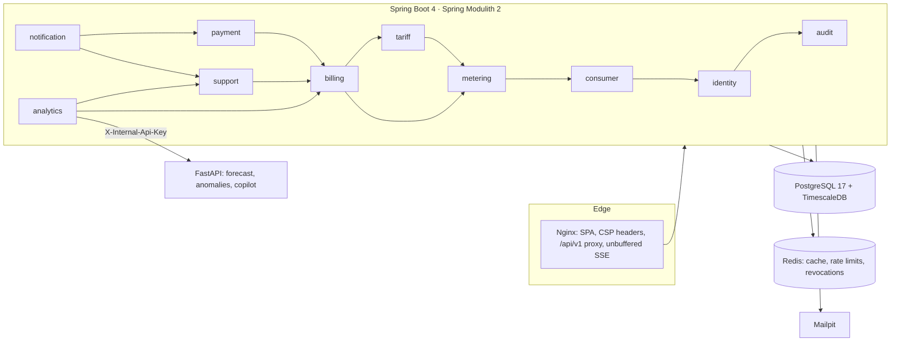

# GridIQ architecture

GridIQ is a modular monolith for transactions plus a separate Python service for analytics. The Core API owns every
financial record and the public API. The ML service is stateless: the Core API sends it the data it needs and stores
the results. A single Angular application talks to the Core API through Nginx on the same origin.

## Modules

Each module exposes a small public API (interfaces, records and events) in its root package and keeps controllers,
stores and services in `internal`. `ModularityTests` verifies the declared dependencies on every build.

| Module | Owns | Public API |
| --- | --- | --- |
| identity | Users, Argon2id passwords, JWT access tokens, rotating refresh cookies, staff RBAC | `CustomerIdentity`, `StaffDirectory`, `UserDirectory` |
| consumer | Accounts, premises, meters, status changes | `MeterDirectory`, `AccountDirectory` |
| metering | Hourly readings, VEE, imports and exports, AMI simulator, anomaly register | `MeterUsage`, `AnomalyRegistry`, `MeteringEvents` |
| tariff | Versioned plans and the pricing engine | `TariffPricing`, `TariffPlan` |
| billing | Invoices, line items, notes, late fees, billing runs, the receivable ledger | `BillingLedger`, `BillingStatistics`, `BillingEvents` |
| payment | Checkout, idempotency, sandbox gateway, webhooks, receipts | `PaymentEvents` |
| support | Complaints, SLA sweeps, comments, CSAT, outages | `SupportDirectory`, `SupportEvents` |
| notification | In-app notifications, SSE streams, email | event listeners only |
| analytics | Dashboards, forecasts, ML client, copilot context, anomaly scans, budget alerts | `AnalyticsEvents` |
| audit | Append-only audit log | `AuditAction` event |

Cross-module side effects travel as events. Audit entries and notifications use `@ApplicationModuleListener`, so they
run after the business transaction commits and are recorded in the JDBC event publication registry.

## Key flows

**Billing.** A run takes each active meter, reads the month's validated hourly intervals (flagged hours are excluded,
at least 90% coverage is required), picks the tariff in force on the first day, carries the previous kWh solar credit
forward and prices the intervals. The bill, its line items and a journal are written in one transaction per meter, so
one failing meter does not stop the run. A unique `(meter, year, month)` constraint and the run's `Idempotency-Key`
make retries safe. A trigger rejects any change to an issued bill's amounts; corrections are credit or debit notes.

**Ledger.** Every financial event writes a journal of debits and credits. A deferred constraint trigger rejects any
journal that does not balance when the transaction commits. The customer statement is the running balance of the
receivable account.

**Payment.** Checkout locks the selected bills in a stable order, prices principal plus late fee on the server and
stores the allocation. A replay with the same `Idempotency-Key` returns the original payment; a different body is
rejected with HTTP 422. A bill with an open checkout cannot be checked out again. The gateway's webhook is verified with
HMAC-SHA256 and a five-minute timestamp window, recorded by event ID and processed under a row lock. Settlement
validates every bill before changing any of them, so a multi-bill payment settles completely or is marked failed for
refund. The built-in sandbox signs and posts its events through exactly this path.

**Forecasts.** The ML service predicts daily consumption bands for the rest of the cycle. The Core API spreads each
day over the meter's own hourly load shape and prices the result with the tariff engine, so time-of-day and slab
effects are exact. Model forecasts are cached in Redis per meter and day, concurrent requests share one model call,
and the Core API falls back to a 14-day run rate within eight seconds if the ML service is unavailable.

**Copilot.** The Core API assembles a read-only context for the signed-in customer (recent bills with line items,
receivables, tariff, forecast, time-of-day split, complaints, outages and meter anomalies). The ML service answers
deterministically from that context and cites the local tariff guide it retrieved with TF-IDF. An optional LLM may
rephrase the answer; any rephrasing that contains a number absent from the facts is discarded.

## Decisions

| Decision | Reason |
| --- | --- |
| Modular monolith instead of microservices | Multi-bill payments, ledger journals and invoices need one ACID transaction. Spring Modulith keeps boundaries enforceable and lets modules be extracted later. |
| Separate Python ML service | scikit-learn and the LLM adapters belong in Python. The service holds no data and needs no database access. |
| JdbcClient over JPA entities | Financial queries, row locks and TimescaleDB functions are explicit SQL. Records map rows without lazy-loading surprises. |
| TimescaleDB for readings | Hypertables and continuous aggregates keep daily and hour-of-day rollups fast as interval data grows. |
| Access token in memory, refresh token in an HttpOnly cookie | Nothing sensitive is stored in `localStorage`; refresh rotation detects token reuse and revokes the session family. |
| Fetch-based Server-Sent Events | The stream carries the bearer token in a header rather than a URL. Persisted notifications remain the source of truth after reconnects. |
| No inline styles | Components use Tailwind utilities only, so the CSP can keep `style-src 'self'`. |
| Auth state cached in Redis for 60 seconds | Every request checks the user's status, role and session version. The cache answers that without a PostgreSQL query and is evicted on any password, role, status or session change; if Redis fails, the check reads PostgreSQL. |
| Per-user AI rate limits with Bucket4j | Copilot chat, ticket triage and forecasts use token buckets in Redis updated with compare-and-swap, so concurrent requests cannot exceed the limit, and every Core API instance shares the same budget. |
| Versioned cache keys instead of key scans | Dashboard caches embed per-account and per-area generation counters. Payments, adjustments and outages bump the counter, so stale entries are never read and nothing has to scan Redis. |

## Differences from the implementation brief

The project followed the GridIQ implementation brief and roadmap. Where the result differs, it is listed here with
the reason, so reviewers can tell a deliberate choice from an omission.

| Brief | Built | Reason |
| --- | --- | --- |
| PrimeNG components | Tailwind CSS v4 with GridIQ's own components: a dialog and side drawer with a focus trap, pager, KPI card, status badge, empty state, error banner and toasts | PrimeNG and the Angular CDK inject inline styles, which the CSP (`style-src 'self'`) blocks. Keeping the CSP strict mattered more than the library. |
| LightGBM or XGBoost, and statsmodels | scikit-learn `HistGradientBoostingRegressor` with quantile loss (the same histogram gradient-boosting method) and an additive Holt-Winters model written in NumPy | Fewer native dependencies in the ML image. Forecasts meet the brief's accuracy gate (MAPE under 15% on the synthetic benchmark). |
| Spring Data JPA with `ddl-auto: validate` | `JdbcClient` and records, with `spring-boot-starter-jdbc` (the JPA starter was removed) | See Decisions. Flyway owns the schema. |
| WebSocket (STOMP) or Server-Sent Events | Server-Sent Events | The brief allows either. See Decisions. |
| OpenTelemetry traces | A correlation ID (`X-Request-Id`) passed from Nginx through the Core API to the ML service, and included in logs and error responses | Distributed traces are not exported. Metrics are covered by Micrometer and the optional Prometheus and Grafana profile. |
| Copilot retrieval with pgvector or FAISS, and model tool calling | TF-IDF retrieval over six local guides. The Core API assembles a read-only context of the customer's bills, forecast, tariff and anomalies, and the answer is built from it. | The knowledge base is small, and building answers from Core API data keeps every figure exact. An optional LLM rewrite is rejected if it introduces a number that is not in that data. |
| `ledger_entries.running_balance` | Double-entry journals (`ledger_journals` and `ledger_entries`) that must balance at commit; statements calculate the running balance when read | A stored running balance would need serialized writes per account and could drift from the journals. |
| An `AUTO_PAY` payment method with mandate execution | Customers turn auto-pay on or off (`PATCH /consumers/me/auto-pay`). Each issued bill on an enrolled account is paid with method `AUTO_PAY` (migration V7) through the gateway's signed webhook path, with an idempotency key derived from the bill. A daily 06:30 IST sweep, also run on demand with `POST /ops/payments/auto-pay/run`, pays bills that were open before enrolment. | There is no bank mandate registration (e-NACH or UPI AutoPay); the sandbox gateway approves the charge. |
| Stripe and Razorpay test-mode adapters | A `PaymentGateway` interface, chosen per webhook provider by `PaymentGateways`, with the HMAC-signed sandbox as its only implementation | Running without paid accounts or keys. A Stripe or Razorpay adapter would implement the same interface and webhook verification. |
| Outage statuses `INVESTIGATING` to `RESOLVED` | Adds `SCHEDULED` (migration V6), the starting status for planned maintenance | "Investigating" describes an unplanned fault, not scheduled work. |
| ML endpoints `/copilot/respond` (brief) or `/copilot/chat` (roadmap) | `/ml/v1/copilot/respond` and `/ml/v1/copilot/triage` | Follows the brief. Triage serves the support desk assistant. |
| `@defer` blocks for heavy charts | ECharts loaded through a dynamic import on the first chart render; the confirmation dialog uses `@defer` | Same effect: ECharts, the icon set and the dialog code stay out of the initial bundle (343 kB, 91 kB gzipped). |
| k6 load test with 100 virtual users and a mixed workload (roadmap) | `K6_PROFILE=mixed`: 100 virtual users on the customer read paths plus forecasts, Copilot chat and the executive overview at fixed arrival rates (p95 of 10 ms, 0% errors over 29,283 requests); the default smoke profile uses 25 | Payments and ingestion are not in the load mix, because each payment is a real ledger write that would change the demo data. |
| Regional AT&C loss heatmap | A regional table on the executive overview: metered vs billed energy (a loss proxy), collection efficiency, overdue amounts and open anomalies for the last three billed months | The demo data has no feeder or distribution transformer topology, so technical losses cannot be separated; the proxy measures commercial and data-quality gaps. |

Built from the roadmap in the polish pass: an anonymous peer comparison on the customer dashboard (last 30 days
against meters of the same connection type and load band, shown only when at least four peers exist), the regional
loss-proxy table, a Kanban view of the support desk, a Ctrl+K / Cmd+K command palette with record search, CSV export
from tables, VEE tools for staff (interval inspection, estimation, audited revision, CSV and Green Button import and
the AMI simulator), a tariff draft editor and README screenshots. Not built: a map-based loss heatmap and a Lighthouse
accessibility audit. Interactive API docs are on at `/swagger-ui.html` and `/v3/api-docs` on the Core API in the dev
profile, and Nginx blocks both at the edge.

## Versions

| Component | Version |
| --- | --- |
| Java baseline and Maven Wrapper | Java 21 (verified on JDK 25) and Maven 3.9.16 |
| Spring Boot, Spring Modulith and Springdoc | 4.2.0, 2.2.0 and 3.2.1 |
| Flyway and Testcontainers | 12.11.0 and 2.0.5 |
| OpenPDF and ZXing | 2.4.0 and 3.5.3 |
| Angular, Tailwind CSS and ECharts | 21.2, 4.3 and 6.1 |
| Python, FastAPI, scikit-learn and NumPy | 3.12+, 0.165.0, 1.9.0 and 2.4.2 |
| Storage | PostgreSQL 17 with TimescaleDB Community Edition 2.x and Redis 7.2 |

GridIQ source is MIT licensed. Continuous aggregates require TimescaleDB Community Edition, which is free for
self-hosting under the Timescale License. The Redis 7.2 series is BSD 3-Clause licensed.

## Known limits

- Live notifications fan out through Redis pub/sub (channel `gridiq:notifications`), so every Core API instance
  delivers them to its own SSE clients. A message published while Redis is down is lost; the notification itself is
  persisted and appears on the next fetch.
- The ML service runs two Uvicorn workers. Prometheus metrics from the service reflect the worker that serves the scrape.
- Only the built-in sandbox gateway is implemented. Stripe or Razorpay adapters would implement `PaymentGateway`.
- Auto-pay charges go through the sandbox gateway; no bank mandate is registered.
